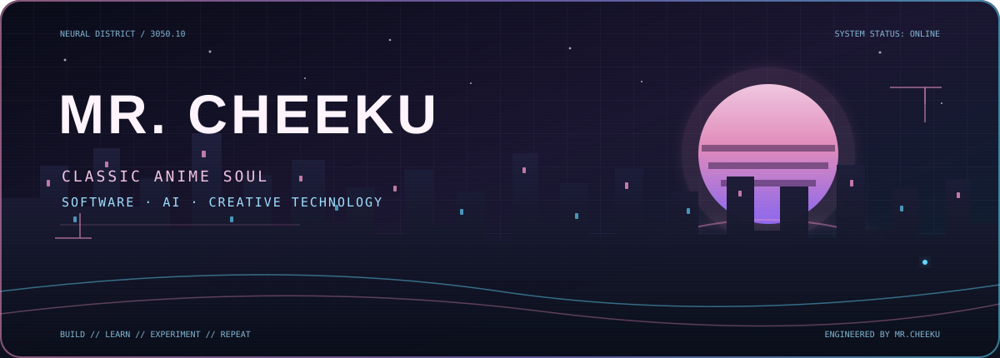

<table>
<tr>
<td width="68%" valign="middle">

<h1>Hey, I'm <strong>Mr.Cheeku</strong> 👋</h1>
<h3>Classic Anime Lover × Tech Creator</h3>

<strong>Software Developer</strong> · <strong>AI Enthusiast</strong> · <strong>BSSE Student</strong>

  
  
  

  
  
  

</td>
<td width="32%" align="center" valign="middle">

THE ORIGINAL ANIMATED IDENTITY VISUAL

</td>
</tr>
</table>

---

## ✦ 01 / The Human Behind the Interface

I'm **Mr.Cheeku** — a **BSSE student**, Software Developer, AI Enthusiast, and classic anime lover. I enjoy bringing creative ideas to life through software, exploring emerging technology, and building practical tools with a distinctive visual identity.

My world sits somewhere between late-night anime scenes, futuristic interfaces, curious experiments, and the endless possibilities of code.

### Current missions

| Signal | Focus |
|:--|:--|
| **01** | 💻 Software development and application design |
| **02** | 🤖 Artificial intelligence and AI-assisted workflows |
| **03** | 📱 Application development |
| **04** | 🛡️ Defensive cybersecurity and secure-by-design thinking |
| **05** | 🧠 Problem solving and technical experimentation |
| **06** | 📚 Continuous learning and university studies |

---

## ✦ 02 / The Developer Arsenal

### Languages

  

### Development environments

  

### AI, workflow and tools

  

### Platforms

  

---

## ✦ 03 / What I Like to Build

<table>
<tr>
<td width="50%" valign="top">

### 🤖 AI Projects

Exploring AI-assisted applications, intelligent workflows, automation, and practical ways to integrate AI into software.

</td>
<td width="50%" valign="top">

### 💻 Software Projects

Building useful applications with an emphasis on functionality, clean interfaces, security, and usability.

</td>
</tr>
<tr>
<td width="50%" valign="top">

### 🛡️ Cybersecurity

Building defensive security tools focused on identifying issues, understanding risks, and improving security.

</td>
<td width="50%" valign="top">

### 📱 Developer Tools

Creating utilities and tools that make development, learning, and everyday workflows easier.

</td>
</tr>
</table>

---

## ✦ 04 / Live Developer Telemetry

  
  

  
  

  

---

## ✦ 05 / Contribution Transmission

  

---

## ✦ 06 / Open a Channel

  
  
  
  

> **Build. Learn. Experiment. Improve. Repeat.**

### 🚀 Building the future, one project at a time.

**Engineered by Mr.Cheeku**

CLASSIC ANIME SOUL · FUTURE BUILDER · SYSTEM 3050

